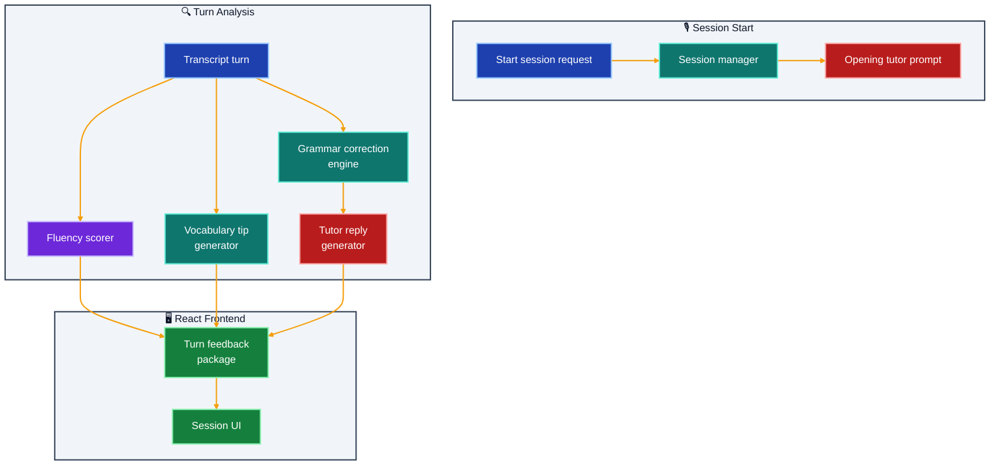

# FluentPal Voice Tutor

Realtime voice tutoring starter with transcript and correction pipeline placeholders.

## What It Does

- Starts tutoring sessions by learner level and scenario
- Processes transcript turns with grammar and fluency analysis
- Returns correction notes, vocabulary tips, and tutor follow-ups
- Maintains turn history within session state

## Implemented Feature Slice

- Session bootstrap with level and scenario selection
- Turn-by-turn transcript analysis endpoint
- Rule-based grammar correction suggestions
- Fluency scoring and vocabulary tips per turn
- Structured response schemas for frontend rendering

## Architecture



## Outcome

- Enables iterative speaking practice with immediate feedback
- Gives measurable fluency indicators per learner turn
- Provides a ready base for future STT/TTS integration

## Quick Start

### Prerequisites

- [UV](https://docs.astral.sh/uv/) installed
- [Node.js 20+](https://nodejs.org/)

### 1. Backend

```bash
cd fluentpal-voice-tutor/backend
uv sync

cp .env.example .env   # all values have sensible defaults

uv run uvicorn app.main:app --reload --port 8000
```

### 2. Frontend

```bash
cd fluentpal-voice-tutor/frontend
npm install
npm run dev
# → http://localhost:5173
```

### 3. Docker Compose (optional)

```bash
docker-compose up --build
```

---

## Environment Variables

| Variable | Default | Description |
|---|---|---|
| `FRONTEND_ORIGIN` | `http://localhost:5173` | CORS allowed origin for the React frontend |
| `LOG_LEVEL` | `INFO` | Python logging verbosity (`DEBUG` \| `INFO` \| `WARNING` \| `ERROR`) |

---

## Project Structure

```
fluentpal-voice-tutor/
├── backend/
│   ├── app/
│   │   ├── api/routes.py           # POST /api/session, POST /api/turn, GET /api/health
│   │   ├── core/config.py          # Pydantic Settings — CORS, log level
│   │   ├── models/schemas.py       # StartSessionRequest/Response, TutorTurnRequest/Response
│   │   ├── services/tutor.py       # Session store, grammar rules, fluency scorer, vocab tips
│   │   └── main.py
│   ├── pyproject.toml
│   └── .env.example
├── frontend/
│   ├── src/
│   │   ├── App.jsx                 # Session start form + turn-by-turn conversation UI
│   │   └── lib/api.js              # startSession(), sendTurn() typed API calls
│   └── package.json
├── docker-compose.yml
└── README.md
```

---

## API Reference

### `POST /api/session`

**Request:**

```json
{
  "learner_name": "Maria",
  "level": "B1",
  "scenario": "job interview"
}
```

**Response:**

```json
{
  "session_id": "a3f9c1d2-4b8e-...",
  "opening_prompt": "Hello Maria! Let's practice a job interview. I'll play the interviewer. Tell me about yourself."
}
```

---

### `POST /api/turn`

**Request:**

```json
{
  "session_id": "a3f9c1d2-4b8e-...",
  "transcript": "I have work in software for five years and I am interesting in AI engineering."
}
```

**Response:**

```json
{
  "session_id": "a3f9c1d2-4b8e-...",
  "corrected_text": "I have worked in software for five years and I am interested in AI engineering.",
  "grammar_notes": [
    "'have work' → 'have worked' (present perfect requires past participle)",
    "'interesting in' → 'interested in' (adjective form for personal state)"
  ],
  "fluency_score": 68,
  "vocabulary_tips": [
    "Consider 'specialized in' instead of 'interested in' for stronger professional phrasing"
  ],
  "tutor_reply": "Good effort, Maria! Your sentence structure is coming along well. Can you tell me about a specific project you worked on?"
}
```

### `GET /api/health`

```json
{ "status": "ok" }
```

---

## Logging

- Python logging is configured in app startup and controlled by LOG_LEVEL.
- Frontend API logging is controlled by VITE_LOG_LEVEL.
